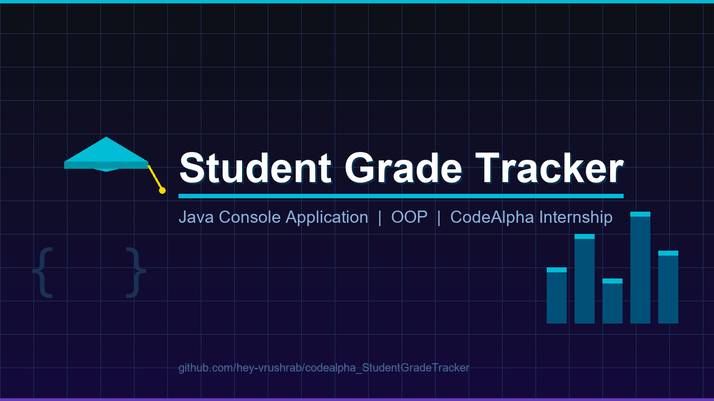

<div align="center">



<br>


# 🎓 Student Grade Tracker

> A clean, interactive Java console application to manage student records, calculate totals, averages, and performance statistics — all from the terminal.

</div>

---

## 📋 Table of Contents

- [Overview](#-overview)
- [Features](#-features)
- [Demo](#-demo)
- [Project Structure](#-project-structure)
- [Getting Started](#-getting-started)
- [Usage](#-usage)
- [How It Works](#-how-it-works)
- [Contributing](#-contributing)
- [License](#-license)

---

## 🌟 Overview

**Student Grade Tracker** is a lightweight Java console application designed to record and analyze student academic performance. It allows you to add multiple students with their marks across subjects, and instantly computes key statistics without any external libraries.

Built with clean OOP principles using a dedicated `Student` class and a main driver class `StudentGradeTracker`.

---

## ✨ Features

| Feature | Description |
|---|---|
| ➕ **Add Students** | Enter student name, USN, and subject-wise marks |
| 📊 **Auto Statistics** | Calculates Total, Average, Highest & Lowest marks |
| ✅ **Input Validation** | Rejects marks outside the 0–100 range |
| 📋 **Display All Records** | View all student profiles at once |
| 🔄 **Loop Menu** | Keeps running until you choose to exit |
| 💡 **Zero Dependencies** | Pure Java — no external libraries needed |

---

## 🎬 Demo

```
===== STUDENT GRADE TRACKER =====
1. Add Student
2. Display All Students
3. Exit
Enter your choice: 1

Enter student name: Vrushrab
Enter USN: 1AT22CS101
Enter number of subjects: 3
Enter marks for subject 1: 88
Enter marks for subject 2: 92
Enter marks for subject 3: 79
Student added successfully!

===== STUDENT GRADE TRACKER =====
1. Add Student
2. Display All Students
3. Exit
Enter your choice: 2

Name: Vrushrab
USN: 1AT22CS101
Total: 259
Average: 86.33333333333333
Highest: 92
Lowest: 79
```

---

## 📁 Project Structure

```
codealpha_StudentGradeTracker/
│
├── StudentGradeTracker.java   # Main driver class with menu loop
├── README.md                  # Project documentation
└── banner.png                 # Project banner
```

> **Note:** The `Student` class is defined within the same `.java` file for simplicity.

---

## 🚀 Getting Started

### Prerequisites

- **Java JDK 8+** installed on your system
- A terminal / command prompt

### Installation

1. **Clone the repository**
   ```bash
   git clone https://github.com/hey-vrushrab/codealpha_StudentGradeTracker.git
   cd codealpha_StudentGradeTracker
   ```

2. **Compile the program**
   ```bash
   javac StudentGradeTracker.java
   ```

3. **Run the program**
   ```bash
   java StudentGradeTracker
   ```

---

## 📖 Usage

Once running, you'll see a menu with 3 options:

| Option | Action |
|--------|--------|
| `1` | Add a new student with name, USN, and marks |
| `2` | Display all student records with statistics |
| `3` | Exit the application |

### Input Rules
- Marks must be between **0 and 100** (invalid entries are re-prompted)
- Number of subjects must be **greater than 0**

---

## ⚙️ How It Works

```
┌─────────────────────────────────────────────┐
│              StudentGradeTracker             │
│  ┌─────────────────────────────────────┐    │
│  │  ArrayList<Student> students        │    │
│  │                                     │    │
│  │  addStudent()  → reads input        │    │
│  │  displayStudents() → prints all     │    │
│  └─────────────────────────────────────┘    │
│                                             │
│              Student (class)                │
│  ┌─────────────────────────────────────┐    │
│  │  name, usn, marks[]                 │    │
│  │  getTotal()   → sum of marks        │    │
│  │  getAverage() → total / count       │    │
│  │  getHighest() → max mark            │    │
│  │  getLowest()  → min mark            │    │
│  │  display()    → prints profile      │    │
│  └─────────────────────────────────────┘    │
└─────────────────────────────────────────────┘
```

---

## 🤝 Contributing

Contributions are welcome! Here's how you can help:

1. Fork the repository
2. Create a new branch (`git checkout -b feature/your-feature`)
3. Commit your changes (`git commit -m 'Add some feature'`)
4. Push to the branch (`git push origin feature/your-feature`)
5. Open a Pull Request

---

## 👨‍💻 Author

<div align="center">

**Vrushrab**

[](https://github.com/hey-vrushrab)

*Made with ❤️ as part of the CodeAlpha Java Internship*

</div>

---

## 📄 License

This project is licensed under the **MIT License** — feel free to use, modify, and distribute.

---

<div align="center">

⭐ **If you found this helpful, please star the repository!** ⭐

</div>
